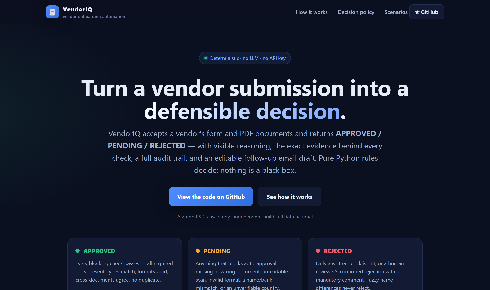

# VendorIQ — vendor onboarding automation (Zamp PS-2 case study)

[](https://github.com/Ashrith-work/vendoriq/actions/workflows/ci.yml)

**🌐 Website: [ashrith-work.github.io/vendoriq](https://ashrith-work.github.io/vendoriq/)** — project overview, pipeline, decision policy and demo scenarios.

[](https://ashrith-work.github.io/vendoriq/)

Independent build (not an official IIT Madras or Zamp product). Accepts a vendor submission (form + PDFs) and returns
**APPROVED / PENDING / REJECTED** with visible reasoning, evidence, an audit trail and an editable follow-up email draft.
Deterministic Python rules decide; **no LLM and no API key are needed**. All data is fictional.

## Run (Windows PowerShell)
```powershell
cd vendoriq
python -m venv .venv
.\.venv\Scripts\Activate.ps1
pip install -r requirements.txt
python sample_data\generate.py        # optional: regenerates the 9 fictional scenarios (also auto-built on first start)
streamlit run app.py                  # opens http://localhost:8501
python -m pytest -q                   # 24 tests, offline
```
macOS/Linux: `source .venv/bin/activate` instead of the Activate line. A fresh SQLite DB is created at `data/vendoriq.db` on first start
(sidebar → *Demo database* → reset). Env overrides: `VENDORIQ_DB`, `VENDORIQ_UPLOADS`.

## How it works
`workflow.run_workflow` is the single entry point used by both the UI and the tests. It yields one event per **real** stage:
Submission received → Document intake → Classification → Field extraction → Validation → Cross-document reconciliation →
Risk assessment → Decision → Email draft → Audit persistence. The Live Run page renders these events as they occur (no timers).

| File | Role |
|---|---|
| `app.py` | Streamlit: Overview, New Submission, Live Run, Verification Detail, Review Queue, History |
| `workflow.py` | Stage orchestration, re-run, reviewer actions |
| `extraction.py` | pdfplumber text, unreadable-scan detection, weighted keyword classifier, regex field extraction with page/evidence |
| `validation.py` | Conditional fields, India rules, country registry, cross-document reconciliation, duplicates, blocklist |
| `decision_engine.py` | Deterministic three-status policy (`VIQ-POLICY-1.0`) |
| `communication.py` | Email drafts (`sent=0`, never auto-sent) |
| `database.py` / `config.py` | SQLite schema + audit; policy, patterns, country registry |
| `sample_data/` | Generator + 9 scenarios; `tests/` | unit + end-to-end tests |

## Decision policy
* **APPROVED** – only if every blocking check is PASS (all applicable fields/docs, types match, formats pass, cross-checks agree, no duplicate).
* **PENDING** – any FAIL/WARN/NOT_CHECKED that blocks approval (missing/wrong/unreadable doc, unsupported country, invalid format, name/bank mismatch, duplicate, uncertain extraction).
* **REJECTED** – only (a) a hit on the written `policy_blocklist` (empty by default; nothing invented) or (b) a human reviewer's confirmed rejection with a mandatory comment. Fuzzy name differences never reject.

## Demo scenarios (Review: *New Submission → ▶ Run a bundled sample scenario*)
| # | Scenario | Expected |
|---|---|---|
| 1 | Domestic PAN+GST, everything consistent | APPROVED |
| 2 | Invoice uploaded as GST certificate | PENDING (WRONG_DOCUMENT) |
| 3 | Bank holder ≠ legal name | PENDING (BANK_HOLDER_MISMATCH) |
| 4 | Germany + Indian PAN-format tax ID | PENDING (COUNTRY_TAX_CONFLICT, no India rules applied) |
| 5 | Duplicate PAN/GSTIN — run after #1 | PENDING (DUPLICATE_IDENTIFIER) |
| 6 | Domestic PAN **without** GST (LLP) | APPROVED, no GST doc requested |
| 7 | International – US EIN | APPROVED, no PAN/GST/IFSC required |
| 8 | Brazil (no rule configured) | PENDING (NOT_CHECKED, never a false pass) |
| 9 | Scanned image-only bank proof | PENDING (UNREADABLE_DOCUMENT) |

## 5-minute demo script
0:00 Overview (empty or seeded) → 0:30 New Submission, show conditional form, run scenario 1 (or upload the PDFs in `sample_data/m_*.pdf` manually) →
1:15 Live Run stages expand with real outputs → 2:15 Decision + Validation tab + Audit trail → 3:00 run scenario 2 (or 3) → show PENDING, evidence, email draft →
4:15 Overview/History counts from SQLite, Review Queue approve with comment, state limitations honestly.
Rehearse order: reset DB → 1 → 2 → 3 → 4 → 5 (duplicate needs 1 first) → 6/7.

## Limitations (stated honestly)
* Format/consistency checks only: no verification of GST/PAN registry status, sanctions, legal existence or bank-account ownership.
* Country registry covers US, UK, DE, SG, AE (+ India for domestic). Any other country → NOT_CHECKED → PENDING.
* No OCR: scanned PDFs/images are preserved, marked unreadable and routed to a human (pytesseract could be added).
* Classification/extraction is keyword/regex-based and tuned to the synthetic documents; real-world layouts need more patterns (or an optional, reviewed LLM extractor).
* Duplicate policy is strict by design: any previous submission with the same PAN/GSTIN/registration/tax ID blocks auto-approval, including legitimate resubmissions.
* Email drafts are never sent. Single-user demo: reviewer name is typed, there is no authentication/RBAC. Not production-hardened.
* Upload limit is 5 MB (deliberate demo constraint; not copied from the IITM portal). OTP/CAPTCHA/payment status are intentionally out of scope. IITM-style change requests (P2) are not implemented.
